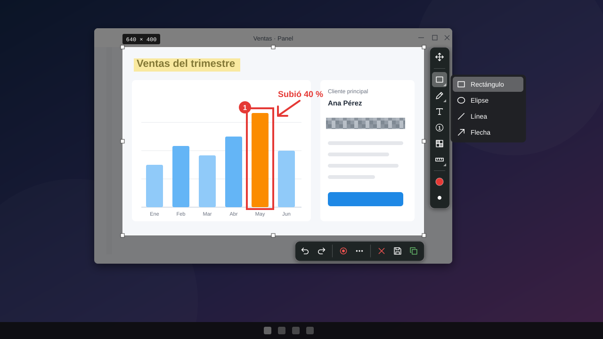

# 🐾 Zarpazo

**Capturas de pantalla, anotaciones y grabación para Windows 10 y 11.** Un atajo, arrastras el área, dibujas encima y copias o guardas. También graba GIF y video con audio.

[](https://github.com/emmanuelLugo/Zarpazo/releases/latest/download/Zarpazo-Setup.exe)

[](https://github.com/emmanuelLugo/Zarpazo/releases/latest)
[](https://github.com/emmanuelLugo/Zarpazo/releases)
[](https://github.com/emmanuelLugo/Zarpazo/actions/workflows/ci.yml)
[](LICENSE)


[🐞 Reportar un fallo](https://github.com/emmanuelLugo/Zarpazo/issues/new?template=bug_report.yml) · [💡 Sugerir una mejora](https://github.com/emmanuelLugo/Zarpazo/issues/new?template=feature_request.yml) · [📋 Cambios por versión](CHANGELOG.md)

<p align="center">
  
</p>
<p align="center"><sub>Ilustración de la interfaz: el área elegida, las herramientas a la derecha y las acciones debajo.</sub></p>

## ✨ Qué tiene

**Captura**
- Captura de **área** arrastrando el mouse, con la pantalla congelada y oscurecida, asas para ajustar la selección y **lupa** con zoom de píxeles y coordenadas.
- Captura de **ventana**: detecta la ventana bajo el cursor y la resalta.
- Atajo global configurable (**Impr Pant** por defecto) e icono en la bandeja.

**Anotaciones** (objetos vectoriales: se pueden mover, borrar, deshacer y rehacer)
- Rectángulo, elipse, línea, flecha, lápiz y resaltador.
- Texto, numeración de pasos, regla y cuentagotas de color.
- **Pixelado** para ocultar datos sensibles.

**Salida**
- Copiar al portapapeles (también como archivo, para pegar la ruta en una consola) y guardar como **PNG o JPG**.
- **Guardado automático** en una carpeta, con plantilla de nombre (`{fecha}`, `{hora}`, `{n}`).
- **Embellecer**: fondo en degradado, margen, esquinas redondeadas y sombra al copiar o guardar.
- **Fijar** la captura sobre la pantalla (`Ctrl+P`), siempre visible y con opacidad.
- **Copiar texto** de una imagen con OCR (`Ctrl+T`).

**Grabación**
- **GIF** y **video MP4** de un área (`Ctrl+G`), con micrófono y sonido de Windows, pausa, cuenta atrás de 3-2-1 y volumen por fuente.
- Repetir la última área con un solo atajo (`Ctrl+Alt+R`).
- Efectos: halo en el puntero, anillos al hacer clic y atajos de teclado mostrados en pantalla. Las letras que escribes nunca se muestran, así que tus contraseñas no salen en el video.
- **Recortar** el video grabado antes de guardarlo.

**Y además**
- **Historial** de capturas y grabaciones con miniaturas, para reabrirlas y seguir editando.
- Iniciar con Windows, ajustes de calidad (fotogramas, bitrate, JPG) y una sola instancia en ejecución.

> Zarpazo está pensado para varios monitores y distinto escalado (PerMonitorV2), pero hasta ahora solo se ha probado en un monitor al 100 %. Si lo usas con varios, tu reporte es muy valioso.

## ⬇ Instalar

1. [Descarga `Zarpazo-Setup.exe`](https://github.com/emmanuelLugo/Zarpazo/releases/latest/download/Zarpazo-Setup.exe).
2. Ábrelo. Se instala solo para tu usuario, **sin permisos de administrador**.

> **El instalador no está firmado.** Windows puede mostrar «Windows protegió su PC»: pulsa **Más información** y luego **Ejecutar de todas formas**. Descarga siempre desde esta página.

**Sin instalar:** en cada [versión](https://github.com/emmanuelLugo/Zarpazo/releases/latest) hay dos ejecutables sueltos.

| Archivo | Tamaño | Requisitos |
| --- | --- | --- |
| `Zarpazo.exe` | ~75 MB | Ninguno, trae todo incluido |
| `Zarpazo-ligero.exe` | ~25 MB | [.NET 8 Desktop Runtime](https://dotnet.microsoft.com/download/dotnet/8.0) |

> En Windows 11, si `Impr Pant` abre el recorte de Windows, desactiva *Configuración → Accesibilidad → Teclado → Usar el botón Impr Pant para abrir el recorte de pantalla*, o cambia el atajo en la configuración de Zarpazo.

## 🗑 Desinstalar

*Configuración de Windows → Aplicaciones*. Tus ajustes y tu historial se conservan a propósito, por si vuelves a instalar.

## 🛠 Para desarrolladores

Zarpazo es C# con .NET 8 y WPF. Necesitas el [SDK de .NET 8](https://dotnet.microsoft.com/download/dotnet/8.0) en Windows.

```powershell
dotnet run --project Zarpazo        # ejecutar
dotnet test                         # pruebas (tardan cerca de un minuto)
pwsh tools\publish.ps1              # Zarpazo.exe y Zarpazo-ligero.exe en publish\
pwsh tools\build-installer.ps1      # instalador con Inno Setup 6 en publish\
```

La estructura, las decisiones técnicas y cómo colaborar están en [CONTRIBUTING.md](CONTRIBUTING.md). El plan de funciones completo, en [PLAN.md](PLAN.md).

## 📄 Licencia

[MIT](LICENSE) © 2026 provisorio43
